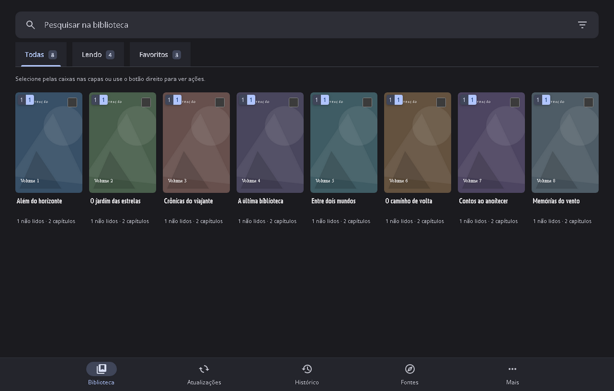
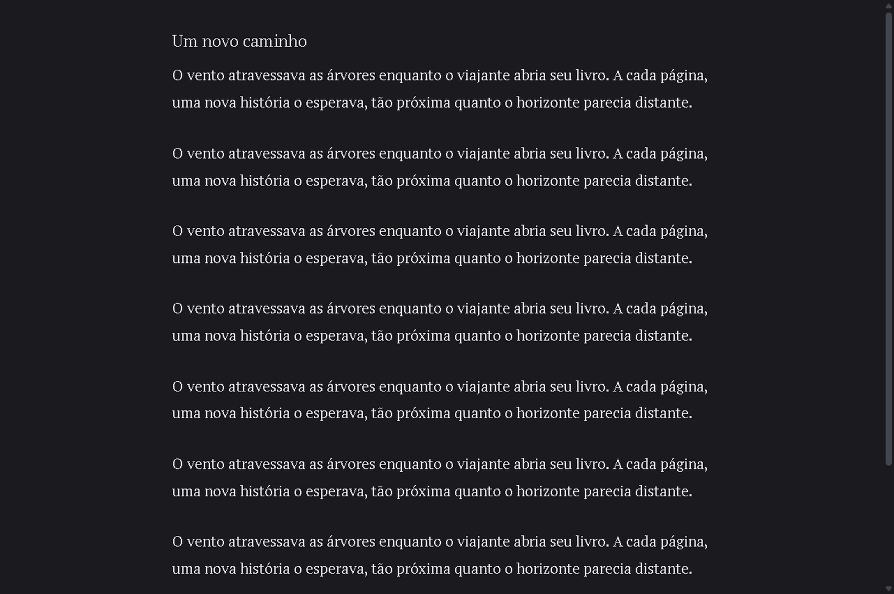

<p align="center">
  
</p>

<h1 align="center">Reader Desktop</h1>

<p align="center">
  <strong>Suas novels, sua biblioteca, seu espaço de leitura.</strong>
</p>

<p align="center">
  Leitor de light novels e web novels para <strong>Windows e Linux</strong>,<br>
  criado para uma experiência confortável no computador.
</p>

<p align="center">
  <a href="https://github.com/GuilhermeLourenceto/lnreader-desktop/releases"></a>
  
  <a href="./LICENSE"></a>
</p>

<p align="center">
  <a href="#sobre-o-projeto">Sobre</a> ·
  <a href="#funcionalidades">Recursos</a> ·
  <a href="#download">Download</a> ·
  <a href="#cr%C3%A9ditos-e-origem">Créditos</a>
</p>

---

## Sobre o projeto

O **Reader Desktop** é um aplicativo para descobrir, organizar e ler light novels e web novels diretamente no PC.

Inspirado pelo ecossistema do [LNReader](https://github.com/LNReader/lnreader), o projeto foi adaptado para o uso em **janelas redimensionáveis, mouse, teclado e telas maiores**, com uma interface própria para Windows e Linux. A ideia é reunir biblioteca, capítulos, progresso de leitura e personalização em um só lugar.

## Interface

| Biblioteca | Detalhes da obra |
| :---: | :---: |
|  |  |

<p align="center">
  
</p>

## Funcionalidades

- **Biblioteca organizada:** busca por título e autor, categorias, filtros, ordenação e seleção múltipla.
- **Leitura personalizada:** fontes, espaçamento, largura do texto, rolagem contínua, páginas horizontais e tela cheia.
- **Progresso e histórico:** acompanhe capítulos lidos, marcadores e continue sua leitura.
- **Leitura offline:** baixe capítulos para ler sem conexão.
- **Fontes e descoberta:** instale extensões compatíveis e pesquise obras em diferentes catálogos e idiomas.
- **Temas e idiomas:** modo claro, escuro, preto OLED, diferentes paletas e interface em dez idiomas.
- **Backups:** importe, exporte e programe cópias automáticas da sua biblioteca.

## Download

Baixe a **[v0.4.5 Beta](https://github.com/GuilhermeLourenceto/lnreader-desktop/releases/tag/v0.4.5)** na página de lançamentos:

<p align="center">
  <a href="https://github.com/GuilhermeLourenceto/lnreader-desktop/releases"><strong>Ver releases e baixar o Reader Desktop</strong></a>
</p>

| Sistema | Arquivo |
| --- | --- |
| **Windows 10/11 (x64)** | Instalador `.exe` |
| **Linux (x64)** | `.AppImage` ou `.deb` |

> O Reader Desktop ainda está em **beta** e pode apresentar instabilidades.

### Começando a ler

1. Instale e personalize o idioma e o tema.
2. Em **Fontes**, adicione um repositório de extensões e instale as fontes desejadas.
3. Encontre uma novel, adicione à biblioteca e comece a leitura.

## Compatibilidade com o LNReader

Se você já usa o LNReader no Android, pode importar um **backup ZIP compatível** para trazer sua biblioteca, capítulos e progresso ao Reader Desktop. Também é possível criar backups para exportação.

Recomendamos manter uma cópia dos seus dados antes de restaurar um backup. Saiba mais sobre a [compatibilidade](desktop/docs/COMPATIBILIDADE-ORIGINAL.md).

## Compilar a partir do código

**Requisitos:** Git, Node.js 24 e npm.

```bash
git clone https://github.com/GuilhermeLourenceto/lnreader-desktop.git
cd lnreader-desktop/desktop
npm ci
npm start
```

Para gerar instaladores, execute no sistema correspondente:

```bash
npm run dist:win    # Windows
npm run dist:linux  # Linux
```

Os arquivos gerados ficam em `desktop/release/`. Não é necessário instalar o Android SDK.

Para desenvolvedores: [arquitetura](desktop/docs/ARCHITECTURE.md) · [histórico de versões](desktop/CHANGELOG.md) · [guia de contribuição](CONTRIBUTING.md).

## Contribua

Sugestões, traduções, relatórios de problemas e contribuições de código são bem-vindos. Use as [issues](https://github.com/GuilhermeLourenceto/lnreader-desktop/issues) ou confira o [guia de contribuição](CONTRIBUTING.md).

## Créditos e origem

Um agradecimento especial à **equipe e aos contribuidores do [LNReader](https://github.com/LNReader/lnreader)**, cujo trabalho de código aberto tornou este projeto possível.

O Reader Desktop reutiliza componentes do LNReader, incluindo partes do motor de extensões, formatos de backup, temas e recursos de leitura. Os arquivos de origem e seus créditos são preservados em [`desktop/vendor/lnreader/`](desktop/vendor/lnreader/).

**O Reader Desktop é um projeto independente, não oficial e sem associação direta com a equipe do LNReader.** Seu desenvolvimento e distribuição não representam o projeto original.

Licença: [MIT](LICENSE).

---

<p align="center"><strong>Boas leituras!</strong></p>
