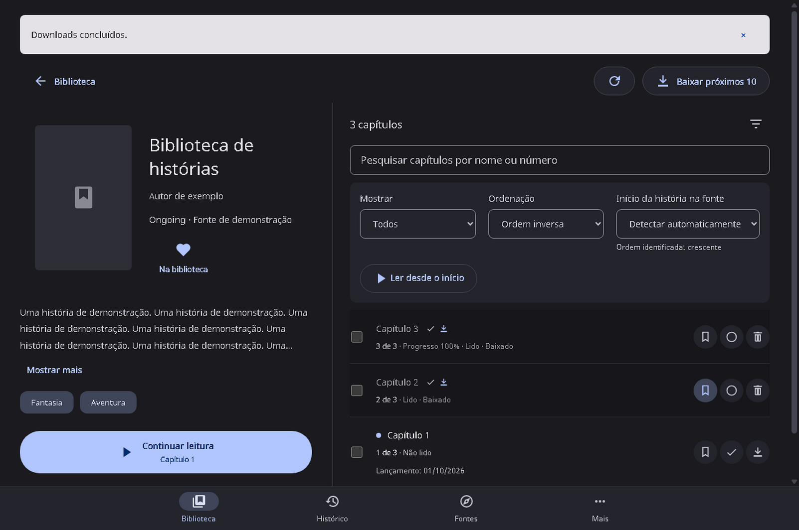
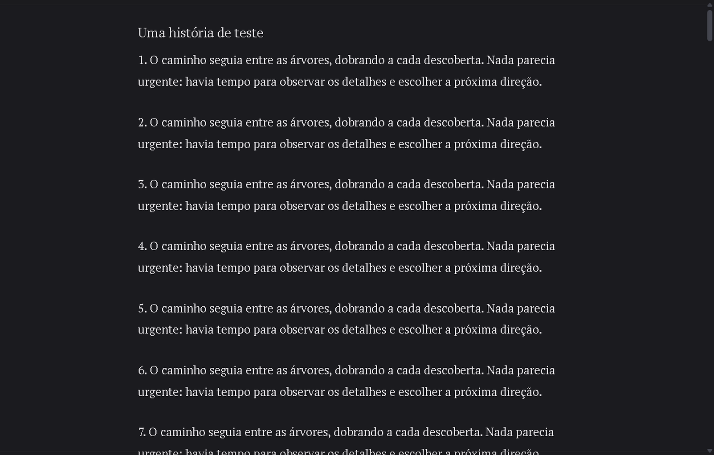

<p align="center">
  
</p>

<h1 align="center">LNReader Desktop</h1>

<p align="center">
  Sua biblioteca de novels no computador.<br />
  Adaptação independente do LNReader para Windows, com suporte às extensões e aos backups do aplicativo original.
</p>

<p align="center">
  
  
  <a href="./LICENSE"></a>
</p>

<p align="center">
  <a href="#recursos">Recursos</a> ·
  <a href="#capturas-de-tela">Capturas de tela</a> ·
  <a href="#instalação">Instalação</a> ·
  <a href="#compilar">Compilar</a> ·
  <a href="#documentação">Documentação</a>
</p>

> Projeto experimental e independente. Não é uma versão oficial dos mantenedores do LNReader. A versão de uso atual é para Windows; a preparação para Linux ainda não foi validada.

## Recursos

- **Biblioteca:** categorias, busca, capas, seleção de várias obras e ações pelo botão direito.
- **Atualizações:** verificação da biblioteca, novos capítulos agrupados por data e obra, busca, filtro de não lidos e ações de leitura e download.
- **Fontes:** extensões no mesmo formato do LNReader, filtro por nome/idioma e busca em todas as fontes instaladas.
- **Obras e capítulos:** informações à esquerda e capítulos à direita em janelas largas, filtros compactos e carregamento automático ao rolar.
- **Leitor:** rolagem contínua ou páginas horizontais, atalhos de teclado, tamanho de fonte, espaçamento, temas e prévia dos ajustes.
- **Leitura sem distrações:** barras ocultas, exibidas por clique, aproximação do topo/rodapé ou navegação com Tab.
- **Progresso:** histórico com capas, capítulos lidos/não lidos, marcadores e numeração independente dos títulos da fonte.
- **Offline:** download de capítulos e imagens, com indicadores de andamento e opção de apagar os downloads.
- **Backups:** importação e exportação ZIP, incluindo formatos do LNReader Android e preservação do progresso.
- **Aparência:** nove paletas do aplicativo e temas do leitor baseados no original.

## Capturas de tela

<p align="center">
  
</p>

<p align="center">
  
</p>

<p align="center"><em>Capturas com dados de demonstração.</em></p>

## Instalação

Versão atual: **0.2.0 experimental**. Veja as [mudanças e medições de desempenho](./desktop/CHANGELOG.md).

**Windows 10/11, 64 bits.** Os instaladores deste projeto são gerados em `desktop/release/` e podem ser disponibilizados nas [Releases](https://github.com/GuilhermeLourenceto/lnreader-desktop/releases) quando publicadas.

Feche o aplicativo antes de atualizar. O instalador solicita permissão de administrador automaticamente. Os binários ainda não possuem assinatura digital confiável; o Controle Inteligente de Aplicativos do Windows pode bloquear a execução, inclusive depois da instalação.

Não use os downloads do repositório Android esperando encontrar o aplicativo desktop: são distribuições diferentes.

## Fontes e extensões

Adicione um repositório de extensões na tela **Fontes**, carregue o catálogo e instale as fontes que deseja usar. Nenhuma fonte ou repositório de terceiros vem instalado por padrão.

O runtime original das extensões é reaproveitado em workers separados da interface, com limites de fila, prazos e cancelamento. Isso reduz o impacto de uma fonte travada; não garante contenção total de memória nem compatibilidade com todas as fontes.

Fontes que exigem login interativo, Cloudflare ou recursos de WebView ainda podem precisar de adaptação. O projeto não tem afiliação com os provedores de conteúdo. Use apenas repositórios de extensões em que você confia.

## Backups e dados

Os dados do Windows ficam em `%APPDATA%/lnreader-desktop`, separados dos arquivos de instalação. A biblioteca e os arquivos baixados devem ser preservados juntos.

Restaurar um ZIP substitui as seções presentes no backup e salva uma cópia do estado anterior. Configurações do Android sem equivalente no desktop podem ser preservadas sem serem aplicadas na interface. Consulte os [detalhes de compatibilidade](./desktop/docs/COMPATIBILIDADE-ORIGINAL.md) antes da primeira migração.

## Compilar

Requer **Node.js 24** e npm. Clone o repositório inteiro: o desktop importa código e recursos das pastas `src/` e `assets/` da raiz.

```sh
git clone https://github.com/GuilhermeLourenceto/lnreader-desktop.git
cd lnreader-desktop/desktop
npm ci
npm run setup
npm start
```

Para gerar o instalador Windows:

```sh
npm run dist:win
```

Para verificar o aplicativo:

```sh
npm run build
npm test
npm run test:smoke
npm run test:pagination
npm run test:reader
```

Não é necessário instalar o Android SDK para executar o desktop. A documentação do aplicativo Android original foi preservada em [README-ANDROID.md](./README-ANDROID.md).

## Documentação

- [Guia completo do desktop](./desktop/README.md)
- [Leitor e atalhos](./desktop/docs/LEITOR.md)
- [Compatibilidade com o original](./desktop/docs/COMPATIBILIDADE-ORIGINAL.md)
- [Isolamento das fontes e limitações](./desktop/docs/ISOLAMENTO-FONTES.md)
- [Revisão de estabilidade](./desktop/docs/REVISAO-ESTABILIDADE.md)
- [Organização do código para GitHub](./desktop/docs/GITHUB.md)

## Créditos e licença

Baseado no [LNReader](https://github.com/lnreader/lnreader), de Rajarshee Chatterjee e seus colaboradores, originalmente inspirado no Tachiyomi. Este port reutiliza o runtime de plugins, auxiliares, recursos visuais e formatos de backup do projeto original.

Licenciado sob a [MIT](./LICENSE). Os avisos de copyright e a licença original foram mantidos.
