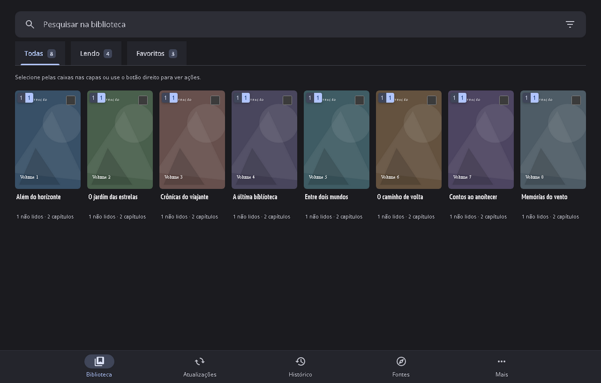
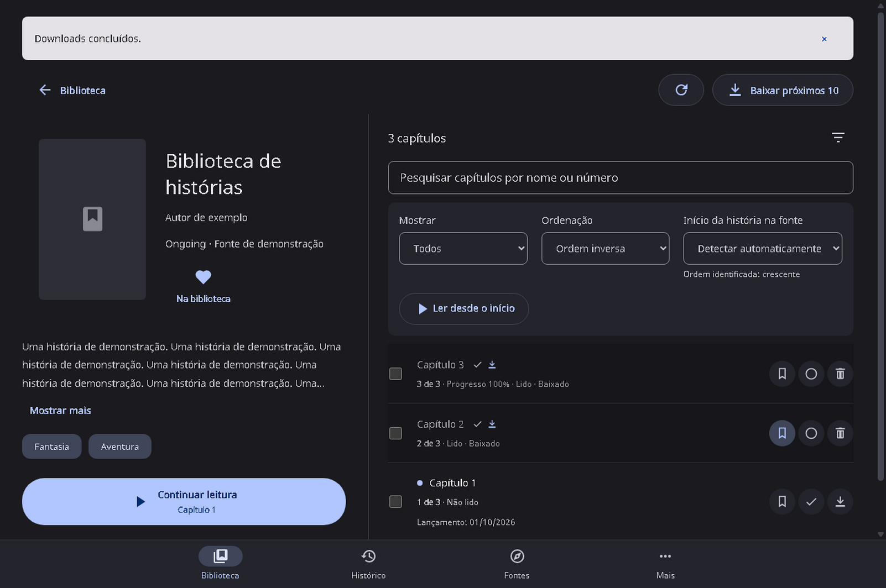
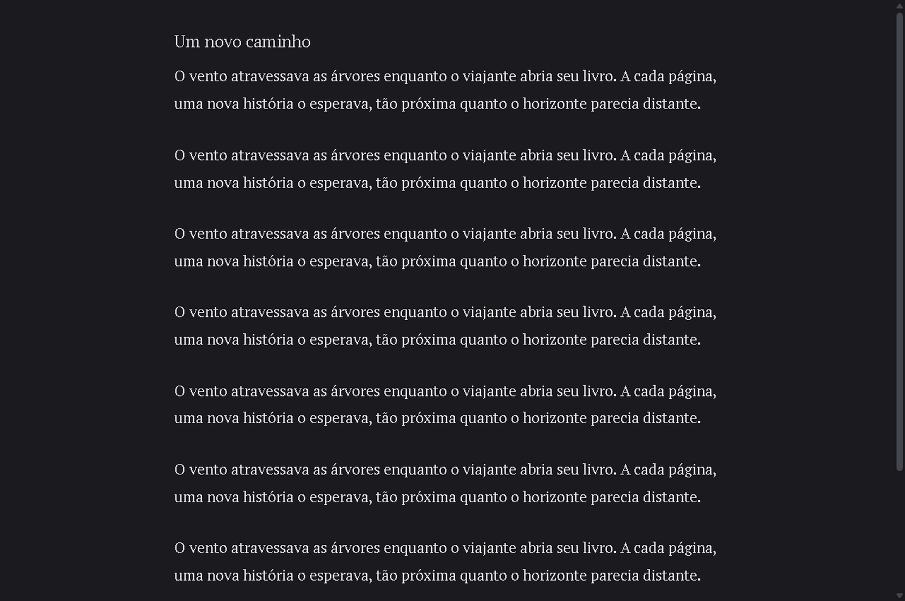
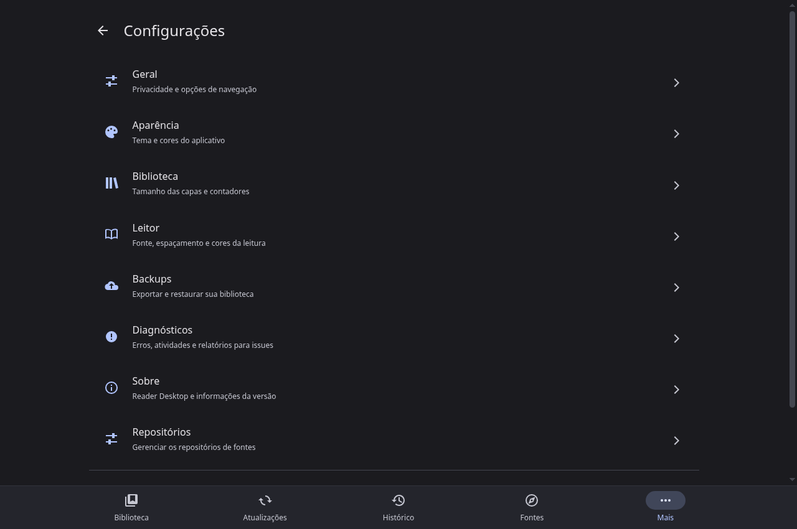
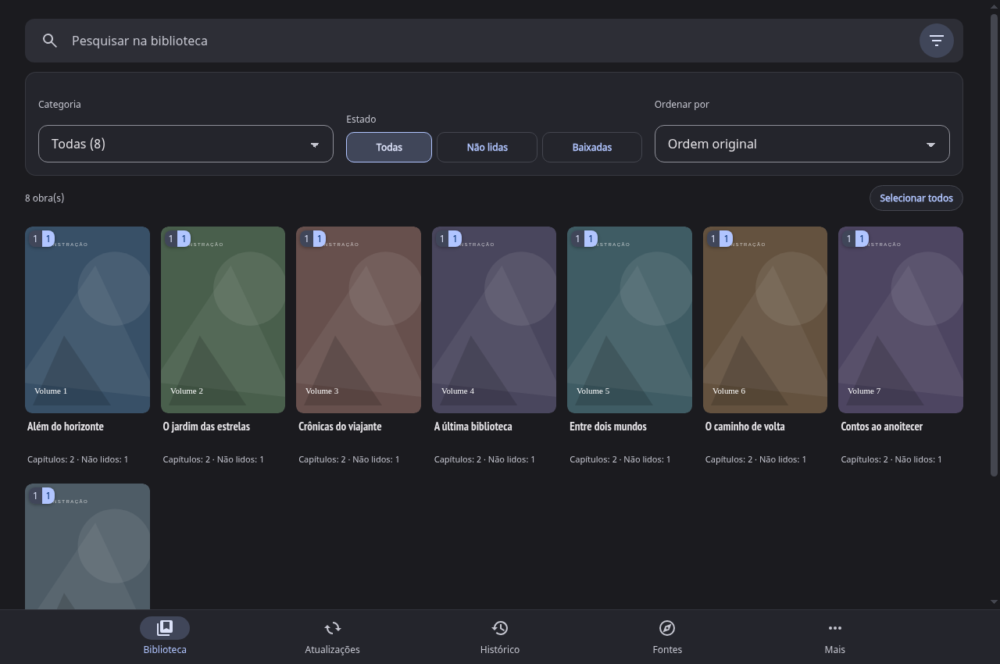
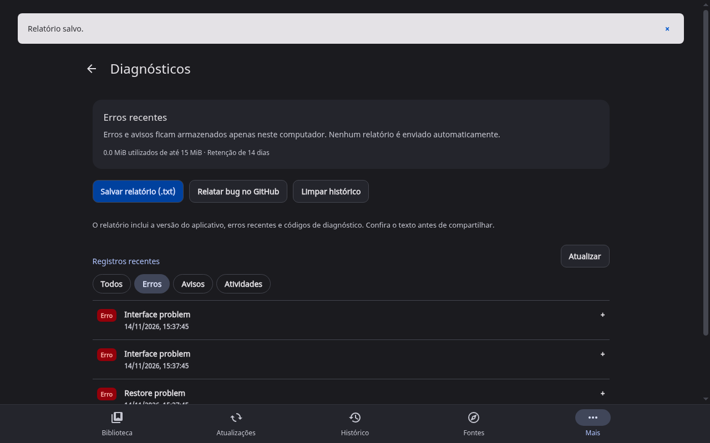

# Reader Desktop

Port para Windows 10/11 e Linux usando Electron. A interface desktop é nova,
adaptada para mouse, teclado e telas maiores. Em janelas largas, os detalhes da
obra ficam à esquerda e a lista de capítulos à direita; em telas menores, as
seções ficam empilhadas. Em telas largas, a lista de capítulos permanece fixa
à direita e rola independentemente. A lista mantém a ordem da fonte por padrão;
o painel de filtros oferece ordem inversa e ordenação por nome/número.
As opções para definir a direção
da fonte e ler desde o início também ficam nesse painel. O código Android antigo continua acessível no histórico Git; a `main` agora contém somente o projeto Desktop.

Versão declarada no código: **0.4.6 Beta (Windows e Linux)**. Ainda não foi publicada uma versão Stable. Consulte o [histórico de versões](CHANGELOG.md).

## Capturas de tela

Capturas **reais do Electron no Debian 13**, geradas por testes gráficos em 14/11/2026 com dados demonstrativos. O visual e as fontes podem variar de acordo com tema, versão e sistema.

| Biblioteca e filtros | Detalhes e capítulos |
| :---: | :---: |
|  |  |
| **Leitura com controles** | **Configurações** |
|  |  |
| **Filtros da biblioteca** | **Diagnósticos e relatórios** |
|  |  |

## Funcionamento

A interface utiliza uma cópia versionada da paleta original,
em `vendor/lnreader/src/theme/md3/defaultTheme.ts`, e as fontes
Noto Sans, PT Sans e PT Serif armazenadas dentro de `vendor/lnreader/assets/`.
Esse conjunto é independente da pasta Android na compilação. A navegação, filtros de categorias, contadores nas
capas, ícones das fontes e leitor em tela inteira seguem o visual do Android.
Os backups ficam em **Mais → Backups**.
Abrir detalhes não adiciona mais uma obra automaticamente à biblioteca.
O progresso usa a escala nativa 0–100 e capítulos são marcados como lidos a
partir de 97%, com histórico registrado separadamente.
Na busca e na lista de novels de uma fonte, a próxima página é carregada
automaticamente ao rolar perto do fim. Um indicador giratório aparece durante
o carregamento; erros mantêm a lista e oferecem nova tentativa. Novas buscas
reiniciam a lista e descartam respostas atrasadas da pesquisa anterior.

Em **Fontes → Buscar obras em todas as fontes**, a pesquisa consulta as fontes
instaladas, com resultados agrupados, paginação e nova tentativa por fonte.
O filtro por nome ou idioma em **Gerenciar fontes** é independente dessa busca.
Na biblioteca, use o botão direito nas capas, Ctrl/Cmd+clique e Shift+clique
para selecionar obras; Ctrl/Cmd+A seleciona os itens correspondentes ao filtro,
mesmo quando a grade é virtualizada. A seleção permite remover obras, zerar
progresso ou baixar capítulos pendentes em lote.
Resetar a leitura limpa progresso e histórico, preservando downloads e favoritos
dos capítulos. Remover da biblioteca também preserva os arquivos baixados.
O histórico mostra as capas, e as configurações do leitor oferecem uma prévia
ao vivo e em tamanho real, renderizada pelo mesmo componente da leitura.
As cinco paletas originais do leitor também estão disponíveis nas configurações
e nos controles durante a leitura, com amostras de cores. A lista e o leitor
mostram a posição local do capítulo (1 de N), independente do número no título.
Os números seguem a sequência de leitura: em fontes decrescentes, a lista
continua na ordem da fonte e a contagem vai de N até 1. A direção é identificada
pelos títulos, números ou datas da fonte; quando não há informação suficiente,
a interface pede confirmação. A opção de início/final da lista é salva por obra.
"Ler desde o início" carrega as páginas pendentes antes de abrir o primeiro
capítulo. Próximo/anterior seguem a direção da leitura, e continuar sem histórico
começa pelo capítulo mais antigo. Filtros e ordenação não alteram a numeração.
O total acompanha os capítulos
carregados da fonte. A data de lançamento aparece quando fornecida pelo plugin;
uma atualização sem data mantém a informação já salva.

## Diagnósticos e relatórios de erro

Em **Mais → Configurações → Diagnósticos**, consulte erros de backups,
fontes, leitura e interface. É possível filtrar por severidade, copiar
o código de um evento e **Salvar relatório (.txt)** para anexar a uma issue.
O botão **Relatar bug no GitHub** abre a página de issues, mas não envia
dados automaticamente.

Os logs são locais e independentes de `library.json` e dos backups ZIP.
Eles são limitados a **três arquivos de 5 MiB** (15 MiB no total) e
**14 dias**, com rotação e descarte automático. Relatórios exportados
manualmente não são apagados pelo aplicativo. Mensagens são reduzidas e
caminhos, URLs, e-mails e credenciais comuns são ocultados; ainda assim,
**revise o relatório antes de compartilhá-lo**, pois erros de fontes de
terceiros podem conter informações inesperadas.

## Executar a partir do código

Requer Node.js e npm. O fluxo foi executado localmente com **Node.js 20.19.2** e **npm 9.2.0**; versões futuras precisam de validação própria. Na pasta `desktop`:

```sh
npm ci
npm run setup
npm start
```

Não é necessário ter a pasta Android, instalar o Android SDK ou as
dependências React Native da raiz. `setup` baixa o runtime do Electron,
inclusive nas versões do npm que não executam automaticamente scripts de
instalação de dependências. Um job do CI verifica a independência em checkout contendo **apenas**
a pasta `desktop/`; a presença do job não substitui a execução com sucesso.

## Gerar instaladores

No Windows:

```sh
npm run dist:win
```

No Linux:

```sh
npm run dist:linux
```

Saída: `desktop/release/`. O Windows produz instalador NSIS `.exe`; Linux
produz `.AppImage` e `.deb`. Gere cada instalador no respectivo sistema.
Para executar um AppImage, habilite a permissão de execução; algumas
distribuições precisam do pacote de compatibilidade do FUSE.

A automação [Desktop builds](../.github/workflows/desktop.yml) prevê lint,
build independente do Android, testes Electron e uma matriz de empacotamento
Windows/Ubuntu. Artefatos de teste não equivalem a instaladores distribuídos. Há ainda
workflows de portabilidade, preparação Linux e stress, com gatilhos próprios.

**Validação:** execute os testes no sistema de destino antes de distribuir um instalador. Consulte o [guia de desenvolvimento](docs/DEVELOPMENT.md).

## Estrutura independente e código original reaproveitado

O **Desktop agora compila sem acessar arquivos do Android**. A pasta
`desktop/vendor/lnreader/` contém uma cópia versionada (snapshot) dos
módulos originais necessários ao leitor. Não é uma segunda instalação
Android, e o código de origem permanece reconhecível:

- `vendor/lnreader/src/plugins/`: mecanismo original de instalação,
  carregamento, fetch, armazenamento, filtros e tipos das extensões;
- `vendor/lnreader/src/services/backup/`: constantes e opções do formato de backup original;
- `vendor/lnreader/src/utils/`: comparação de versões, mensagens de erro
  e paletas originais de leitura;
- `vendor/lnreader/src/theme/`: paleta Material 3 original;
- `vendor/lnreader/assets/`: fontes da interface e logotipo;
- `vendor/lnreader/LICENSE` e `vendor/lnreader/origin.json`:
  licença, procedência e hashes de integridade.

O código específico do Windows/Linux está em `desktop/src/`; os
adaptadores `src/adapters.js` e `src/workerAdapters.js` conectam o SDK
original ao Electron, sem trazer Android SDK, Expo nem React Native.
O armazenamento continua local e os backups ZIP mantêm seu formato.

**Atualizar o SDK original é uma operação explícita:** mantenha os
arquivos de origem em `desktop/.tmp/lnreader-original/` e execute
`node scripts/sync-original-sdk.cjs` a partir de `desktop/`.
O importador usa somente pastas dentro de `desktop/`, recusa links
simbólicos e não remove arquivos originais. O código atual em
`desktop/vendor/lnreader/` continua versionado e funcionando sem
nenhuma importação. A sincronização opcional **não faz parte de
`npm ci`, `npm run build` nem do instalador**.
Ao copiar só a pasta `desktop/` para outro repositório, a compilação
continua funcionando sem ele.

A branch `main` contém o Reader Desktop.

A interface React Native, consultas Drizzle/SQLite e serviços Android
não são incluídos. Os arquivos baixados ficam em `content/`, separados
dos metadados JSON e referenciados por hash, com recuperação e backups
ZIP preservados.

## Fontes

Em **Fontes**, adicione a mesma URL do índice JSON usada no Android, clique
em **Carregar repositórios**, instale uma fonte e escolha **Abrir**. O índice
usa os mesmos campos `id`, `name`, `lang`, `version`, `url`, `site` etc.
Nenhuma fonte ou URL de repositório de terceiros é incluída por padrão.

São aceitos os bundles CommonJS JavaScript do LNReader. Fontes que exigem
Cloudflare, login interativo, sincronização de WebStorage ou execução de
`custom.js`/`custom.css` em WebView ainda podem falhar. Os arquivos de scripts
e estilos personalizados são preservados nos backups, mas não são executados
no leitor desktop. Instale fontes apenas de repositórios confiáveis.

## Consumo de memória da biblioteca

Atualmente, bibliotecas filtradas com mais de 100 obras usam
virtualização de cartões: apenas as linhas visíveis e uma pequena margem
ficam montadas no renderer. O grid mantém capas, badges, seleção, pesquisa,
categorias e menus de contexto. Listas pequenas usam a renderização anterior.
Os metadados das obras e capítulos permanecem em memória, portanto a
virtualização não garante um tamanho fixo de RAM. O projeto possui testes gráficos para bibliotecas grandes.

## Biblioteca, leitura e backups

- Biblioteca, filtros por categoria importada, busca nas fontes, capítulos
  paginados quando a fonte oferece `parsePage`, atualização de capítulos,
  progresso e tamanho de fonte.
- Capítulos abertos são armazenados como `Novels/<fonte>/<obra>/<capítulo>/index.html`,
  com os mesmos IDs e caminhos do Android. Texto fica disponível offline.
- ZIP v2 mantém `Version.json`, `Category.json`, `Setting.json`, `Plugins.json`,
  `NovelAndChapters/`, `Covers/`, `plugins.zip` e `novel-files.zip`.
- Importação do formato antigo com `download.zip` contendo `Plugins/` e `Novels/`.
- Importação de backups Android organizados em uma pasta externa com
  `data.zip`, `plugins.zip` e `novel-files.zip`.
- A restauração **mescla** obras, capítulos, categorias e fontes, preserva
  downloads locais existentes e remapeia IDs em conflito. Preferências Android
  só atualizam o Desktop quando houver valor válido e equivalente: idioma
  suportado, modo claro/escuro, paleta MD3, AMOLED e algumas opções de leitura.
  Campos ausentes, desconhecidos ou incompatíveis nunca geram valores padrão.
  Opções próprias do Desktop (ocultar barras, atraso, pasta de backup etc.)
  permanecem como estavam. Em caso de erro, valores inválidos ou atualização
  parcial, o idioma e as preferências válidas já escolhidas não são
  substituídos por padrões; inglês só é aplicado na primeira instalação ou
  quando o usuário o seleciona explicitamente. A opção de redefinir padrões
  continua sendo uma ação separada. A cópia `before-restore.json` permite recuperação manual.
- Na exportação, somente chaves compreendidas pelo Android são gravadas em
  `Setting.json`; as preferências originais do Desktop são preservadas em
  `Version.json.desktopState.originalSettings`, permitindo uma restauração
  exata no próprio PC sem alterar configurações nem recriar defaults. Os
  modos anônimo/somente baixados são sincronizados em `LIBRARY_SETTINGS`.
  Valores Android sem equivalente (cores dinâmicas, acentos personalizados,
  fontes exclusivas) são preservados. O backup não transfere cookies de
  autenticação entre plataformas.
- Imagens já contidas em backups Android são preservadas e podem ser exibidas
  offline. As ações de download também armazenam imagens quando a fonte permite.
  Há download individual, dos próximos 10 e dos capítulos selecionados, com
  interrupção após o capítulo atual. A fila exige que o aplicativo permaneça aberto.

Use uma cópia de seu backup na primeira migração. A compatibilidade foi
verificada com arquivos de teste seguindo a estrutura do código original;
ainda falta validação com backups reais do usuário e fontes reais variadas.
Em 28/10/2026, o índice oficial `plugins/v3.0.0/.dist/plugins.min.json`
foi testado pelo desktop: 327 fontes listadas e instalação/inicialização da
fonte real Better Novels concluída. A leitura do site dessa fonte não foi
testada. Repita essa conferência opcional de rede com
`npx electron test/repository-smoke.cjs` após compilar.
Também foi validada a Central Novel com
`npx electron test/repository-smoke.cjs --source=centralnovel --browse --read`:
50 obras listadas, detalhes de uma obra com 121 capítulos e leitura de um
capítulo concluída. A chamada de `popularNovels` agora envia as opções de
filtros esperadas pelo Android, e a ponte HTTP preserva a URL final, inclusive
em redirecionamentos. O teste local cobre esse contrato, redirecionamento e
envio de corpo POST em UTF-8.
Backups são importados e exportados por fluxo com suporte a ZIP64 (mais de 4 GiB),
sem limite fixo de 512 MiB para o tamanho total. Permanecem as proteções contra
caminhos perigosos, arquivos duplicados, expansão suspeita, falta de espaço em
disco, mais de 100 mil entradas e falta de espaço para extrair os arquivos.
Metadados JSON são limitados separadamente para proteger a memória. Os jobs
são executados em worker e interrompidos apenas após cinco minutos sem progresso;
backups grandes podem demorar e ocupar espaço temporário em disco.

## Leitura

Detalhes em [`docs/LEITOR.md`](./docs/LEITOR.md).

- As barras superior e inferior somem sozinhas durante a leitura e voltam ao
  aproximar o mouse do topo/rodapé, clicar na página ou navegar com Tab (configurável em
  **Configurações → Leitor**).
- Atalhos: setas, Page Up/Page Down e espaço avançam uma página **dentro do
  capítulo**; Home/End vão ao início e ao fim. As teclas permanecem no capítulo
  atual; Anterior/Próximo trocam de capítulo.
- **Modo de leitura** escolhe entre rolagem contínua (padrão) e páginas
  horizontais; a amplitude do avanço na rolagem vai de **10% a 100%**, com
  valor padrão de **50%**.
- A lista de capítulos carrega mais 100 sozinha ao chegar ao fim, com a bolinha
  girando; páginas de capítulos da fonte também são buscadas automaticamente.
- **Aparência** oferece as nove paletas Material 3 do aplicativo Android
  (incluindo verde, lavanda e roxo), além das cinco paletas de leitura originais.
- A bolinha de carregamento é animada em toda a interface, inclusive com
  "reduzir movimento" ativo no Windows.

## Isolamento das fontes

As fontes executam em Web Workers dedicados, separados da thread da interface.
O carregador e os auxiliares originais continuam sendo usados dentro dos workers.
Cada chamada tem prazo e pode ser interrompida; o pool mantém no máximo seis
workers e libera fontes ociosas quando precisa abrir outra. Arquivos, cache e
HTTP passam por uma ponte limitada. Um loop síncrono em uma fonte pode ser
cancelado sem recarregar o leitor. Detalhes e limites estão em
[`docs/ISOLAMENTO-FONTES.md`](./docs/ISOLAMENTO-FONTES.md).

Dados em `%APPDATA%/lnreader-desktop` no Windows e
`~/.config/lnreader-desktop` no Linux (ou a pasta XDG correspondente).
Feche o app antes de restaurar manualmente `before-restore.json` sobre `library.json`.
Mantenha a pasta `content/` junto desses arquivos; os índices novos dependem dela.

## Validação

```sh
npm run test:all       # build, lint, testes unitários e testes Electron
npm run dist:linux     # gerar AppImage e .deb no Linux
```

Para habilitar também o teste de um arquivo offline de 530 MiB (mais lento e com
uso temporário de disco), execute:

```sh
READER_LARGE_BACKUP_TEST=1 node --test test/zip-streaming.test.cjs
```

Os testes Electron precisam de uma sessão gráfica (X11 ou Xwayland). O teste
`test:diagnostics` verifica mensagens simples, exportação privada de relatório
e geometria da tela em larguras de 800 e 1280 pixels.

Os testes verificam ZIP antigo/atual, ida e volta de dados/arquivos/progresso,
backup parcial, entradas inválidas, dados opcionais ausentes, rejeição de ZIPs
corrompidos e preservação das preferências escolhidas pelo usuário. O teste Electron usa uma fonte de teste
local e uma pasta temporária própria: instala o plugin pelo carregador original,
abre uma obra, lê e salva um capítulo, rejeita scripts no HTML e repete a leitura
offline. A janela de teste fica oculta e fecha ao terminar.

Consulte o [histórico de versões](CHANGELOG.md).
Falta ampliar a validação para outros computadores e versões do Windows.

## Estrutura da pasta

```
desktop/
  src/            pontos de entrada do Electron, rede e backup
  src/features/   biblioteca, leitor, fontes, histórico, downloads e configurações
  src/components/ componentes compartilhados
  src/domain/     regras de novels, leitura, filtros e grade
  src/state/      estado da biblioteca e preferências
  src/infrastructure/ validação de rede, diagnóstico e atalhos
  src/i18n/       traduções
  test/           testes node e testes Electron de interface
  docs/           documentação (compatibilidade, estabilidade, leitor, isolamento)
  docs/screenshots/ capturas de apresentação do Desktop
  tools/          ui-harness.cjs (renderiza a interface no Chrome) e diagnóstico de fonte
  vendor/lnreader/  snapshot local do SDK, paletas, licença e assets originais
  scripts/        manutenção opcional do snapshot
  build/          ícone do instalador
  dist/           saída do build (gerada)
  release/        instaladores e app descompactado (gerada)
```

`dist/` e `release/` são ignorados pelo Git; `npm run build` recria `dist/` e
`npm run dist:win` recria `release/`.

Para conferir telas sem abrir o Electron, `node tools/ui-harness.cjs` gera
páginas em `.tmp/` que carregam o bundle real com uma ponte `desktop` falsa; elas
podem ser abertas no navegador ou capturadas com o Chrome headless.

Não assuma paridade com o LNReader Android: funcionalidades como sincronização
em nuvem, rastreadores, TTS, exportação EPUB e tarefas com o aplicativo fechado
não são oferecidas como recursos desktop confirmados nesta versão.

A janela usa isolamento de contexto, sandbox e Node desabilitado. O leitor
sanitiza HTML. `unsafe-eval` permanece necessário para o carregador original
dentro dos workers. Eles não têm acesso ao DOM nem a Node; Web Worker não é
equivalente a um processo do sistema com memória independente.

## Organização e contribuição

A estrutura de módulos e os limites entre Electron, React, armazenamento e
código original estão descritos em [docs/ARCHITECTURE.md](docs/ARCHITECTURE.md).
Quem deseja contribuir deve começar pelo [guia de desenvolvimento](docs/DEVELOPMENT.md).
Para colaborar ou relatar problemas, consulte
[CONTRIBUTING.md](../CONTRIBUTING.md) e [SECURITY.md](../SECURITY.md).

```sh
npm run lint          # Sintaxe Node e dependências fora de desktop/
npm run format:check  # Formatação dos módulos novos (cobertura incremental)
npm run format        # Formata código próprio (revise o diff antes de commitar)
npm run check         # Lint + formatação incremental + testes unitários
npm run test:journeys # executor de 30 jornadas de interface (Electron)
npm run test:all      # Suíte local completa do Desktop
```

O código original em `vendor/lnreader/` é versionado separadamente e não deve
ser reformatado automaticamente ao modificar módulos próprios do Desktop.

## Atalhos e busca

- **F11** alterna a tela cheia em qualquer tela principal do aplicativo.
- **Fontes** abre inicialmente **Buscar obras em todas as fontes**; a aba Gerenciar fontes continua disponível.
- A busca global prioriza fontes com resultados, sem descartar as demais fontes ainda sendo consultadas.
- **Avanço por página** tem escala de 10 a 100%, com valor inicial de 50%. Configurações anteriormente salvas são mantidas.


## Restaurar configurações e rolar as listas

Em **Mais → Configurações → Restaurar configurações padrão**, confirme para devolver as preferências de aparência, biblioteca e leitura aos valores iniciais. Essa ação **não apaga** livros, fontes instaladas, downloads, histórico ou progresso. Um backup completo continua disponível em **Mais → Backups**.

Ao explorar fontes no Desktop, a roda do mouse também movimenta as listas quando o cursor está nas laterais da janela, fora da coluna central. Áreas com rolagem própria mantêm o comportamento normal.
